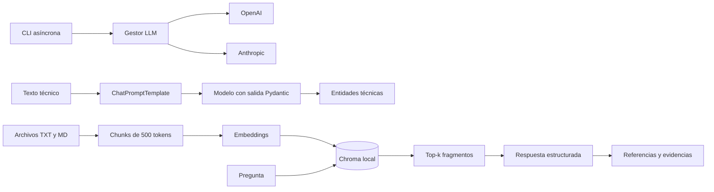

# Arquitectura

## Límites de los componentes

- `llm`: contrato común, selección de proveedor, reintentos y streaming.
- `extraction`: prompt, esquema de entidades y ejecución LCEL asíncrona.
- `rag`: carga, fragmentación, persistencia, recuperación y respuesta respaldada.
- `integrations`: construcción de modelos y embeddings de terceros.
- `cli`: interfaces ejecutables para operación y demostración.

Las dependencias externas quedan detrás de adaptadores. Los servicios aceptan implementaciones
inyectadas, lo que permite verificar la lógica sin red ni credenciales.
